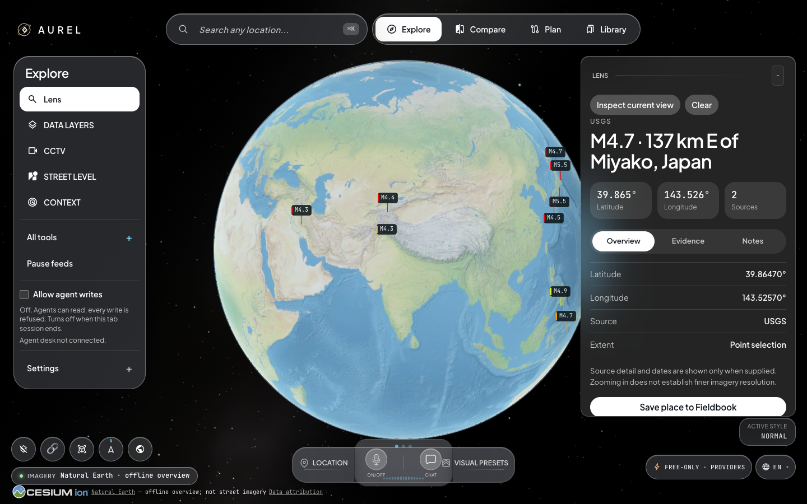
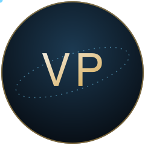
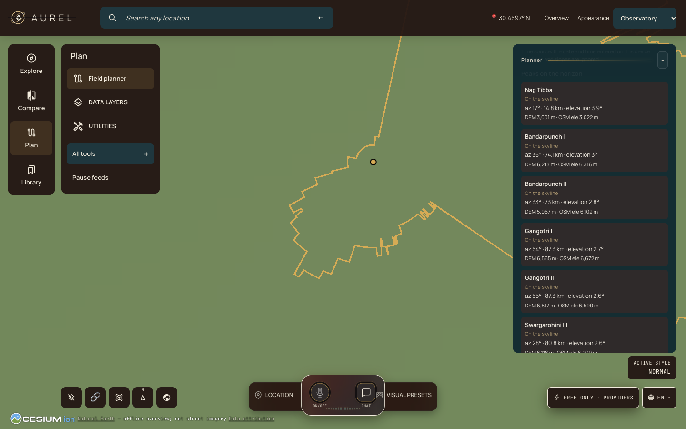
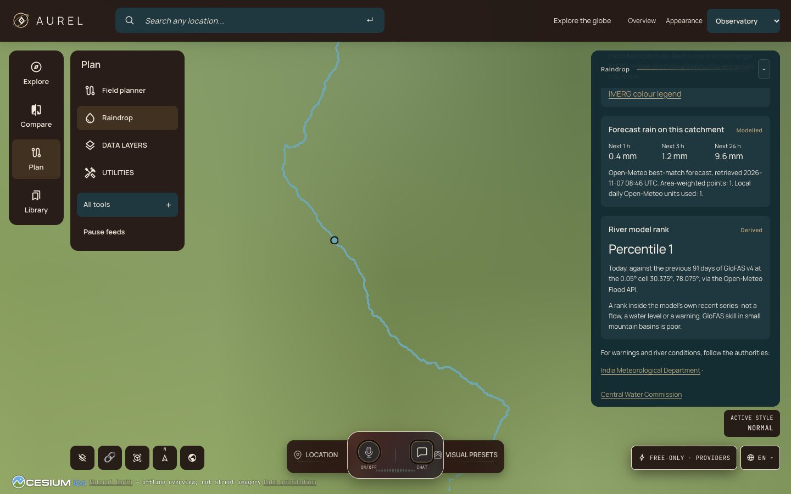
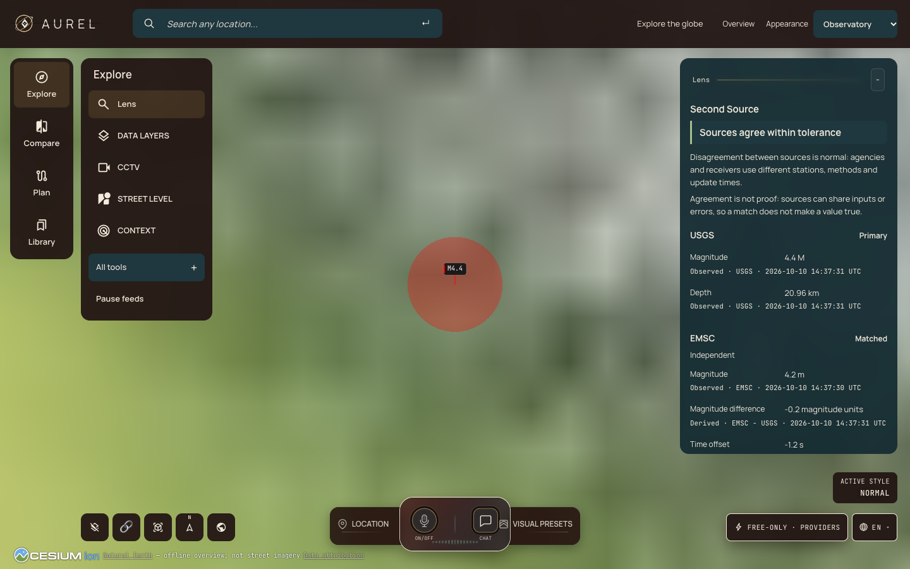
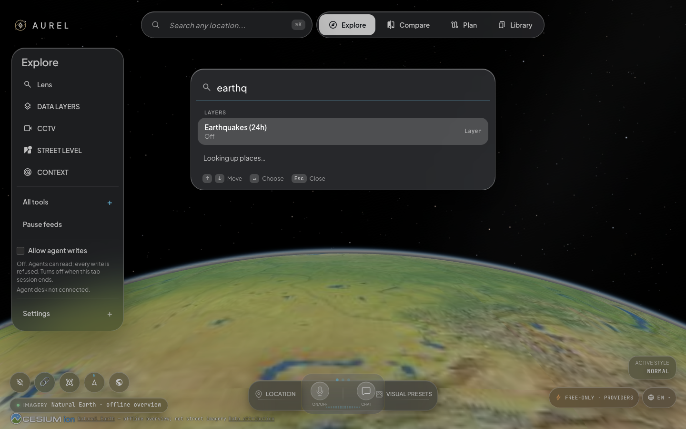
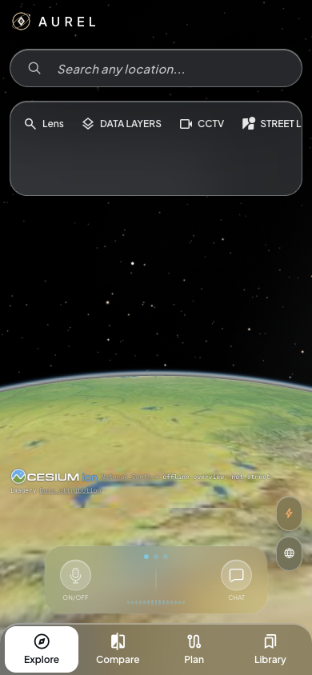
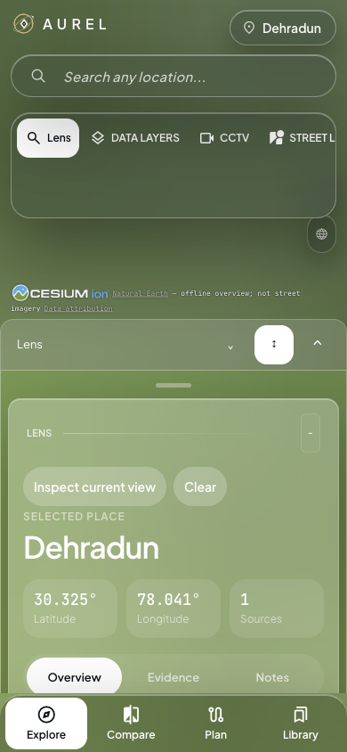

<div align="center">



<br>

[](https://github.com/veyron007)
[](LICENSE)
[](#-quick-start)


### The whole planet, live, on one quiet pane of glass.

**AUREL** turns public signals into a calm, honest instrument panel for Earth.<br>
Aircraft, ships, satellites, quakes, fires, rain, rivers and skylines, all on a photorealistic 3D globe.<br>
Every number says where it came from. Every call stays free.

**[Quick Start](#-quick-start) · [Instruments](#-eight-new-instruments) · [Gallery](#-gallery) · [Performance](#-faster-by-measurement) · [Agents](#-built-for-agents) · [License](#-license)**

<br>



<sub>The Spatial interface. A live USGS quake is selected, and the Lens card shows its position, its source and how many sources agree.</sub>

</div>

---

## 👋 Meet the builder

<table>
<tr>
<td width="140" align="center" valign="top">
<a href="https://github.com/veyron007"></a>
</td>
<td valign="top">

### Varun Pokhriyal &nbsp;·&nbsp; [@veyron007](https://github.com/veyron007)

AUREL is designed, engineered and maintained by Varun Pokhriyal.

Varun shaped AUREL into a personal observatory for the planet. It has its own identity, its own interface, eight new scientific instruments, a free-only data contract, Hindi-first localisation and a measured performance program. It was tuned for Dehradun and the Himalayan foothills first, and for the rest of the planet next.

**What Varun brought to AUREL:**
`design system` · `spatial UI` · `geospatial science` · `hydrology` · `orbital mechanics` · `data provenance` · `MCP agent tooling` · `web performance` · `i18n`

</td>
</tr>
</table>

| AUREL by the numbers | |
| :--- | ---: |
| Commits by Varun | **114** |
| Lines added | **140,000+** |
| New signature instruments | **8** |
| Interface themes designed | **3** |
| Languages supported | **11** |
| Paid APIs required | **0** |

---

## 🌍 Why AUREL

Most "world dashboards" look impressive and say little about how sure they are. AUREL is built the other way round.

- **🪶 Calm by default.** The globe is the brightest thing on screen. Chrome rests when you stop touching it.
- **🧾 Honest by design.** Every card labels its data as *observed*, *modelled* or *derived*, with a source and a timestamp. A missing monitor reads differently from missing data.
- **💸 Free-only by contract.** A Free-only gate keeps every provider call on free tiers, with budget ledgers that refuse a request before it is sent.
- **🏔️ Local first.** Indian city presets, a Dehradun region pack that works offline, and Hindi as a first-class language.
- **🤖 Agent-ready.** An MCP server lets AI agents read the globe and, only when you allow it, write to your Fieldbook.

> AUREL stands for **A**daptive **U**nified **R**econnaissance & **E**xploration **L**ens.

---

## 🧭 Eight new instruments

Varun designed and built each of these as a separate work package with its own tests, QA script and verification record.

| | Instrument | What it does |
| :---: | :--- | :--- |
| 🏔️ | **Kshitij Horizon Engine** | Drop a pin and get the full 360° terrain skyline. It names every peak on it, gives terrain-clipped sunrise and sunset, and predicts shadows. |
| 🌬️ | **Breath** | Real Indian air-quality monitors beside the CAMS model, with Indian NAQI and US AQI computed to the published standards. |
| ⛰️ | **Altitude Ensemble** | Turns a route checkpoint into a mountain-weather sheet at that elevation. It shows ICON, GFS and IFS side by side with an ensemble rain fan. |
| 🛰️ | **Orbit Witness** | Predicts the next Sentinel-2, Landsat or ISS pass over your view. It can watch for the scene to land and fly the camera along the pass. |
| 💧 | **Raindrop** | Click anywhere and a drop traces downhill to the sea. It draws the upstream catchment with rain totals and a river-model rank. |
| 🧰 | **Agent Field Kit** | MCP write tools for places, notes, areas, watches and renders. Each result carries a provenance envelope, and writes stay off until you allow them. |
| 🔍 | **Second Source** | Checks quakes, fires and aircraft against an independent feed. It shows whether they agree, the time offset and the position gap. |
| 🇮🇳 | **Hindi-first AUREL** | Hindi interface, Dehradun presets and honest coverage notes for Indian cities. |

Alongside them sit the AUREL workspaces: **Lens** for any selected place, **Fieldbook** for saved work, a terrain-aware **Planner**, **Chronicle** for evidence through time, **Watchlists**, **Compare**, a **Library**, and an offline **region pack**.

---

## 🖼️ Gallery

<table>
<tr>
<td width="50%"><br><sub><b>Kshitij.</b> The skyline from Lal Tibba, with Bandarpunch, Gangotri and Swargarohini named by azimuth and distance.</sub></td>
<td width="50%"><br><sub><b>Raindrop.</b> A drop from Rajpur follows the terrain into the Song, with forecast rain on its catchment.</sub></td>
</tr>
<tr>
<td width="50%"><br><sub><b>Second Source.</b> USGS and EMSC agree on a quake within tolerance, with the magnitude gap and time offset shown.</sub></td>
<td width="50%"><br><sub><b>Command palette.</b> Press <kbd>⌘</kbd> <kbd>K</kbd> to reach any layer, place or tool.</sub></td>
</tr>
</table>

<details>
<summary><b>📱 On a phone</b></summary>
<br>
<p align="center">

&nbsp;&nbsp;

</p>
</details>

---

## 🎨 Designed, not decorated

Varun ran a judged design tournament for AUREL's look. Six directions were scored by four judging lenses, then refined against the live app. Three themes came out of it:

- **Spatial.** The default look. It uses visionOS-style frosted glass, white pill actions and a single sky-blue accent. Panes turn solid while the camera moves, so the glass never costs frames.
- **Lamplight.** "The parlor with one lamp lit." It pairs oxblood command glass with petrol information surfaces and one brass seam. Every text colour passes WCAG AA contrast.
- **Cyber.** A tactical look for anyone who wants a cockpit.

The design record is in [docs/design/aurel](docs/design/aurel/README.md).

---

## ⚡ Faster by measurement

Varun ran a phased performance program and measured every step with a scripted browser probe:

| Cold load of an empty globe | Before | After |
| :--- | ---: | ---: |
| Requests | 351 | **295** |
| Bytes transferred | 14.2 MB | **11.9 MB** |
| Time to ready | 6.1 s | **3.8 s** |
| Entry JavaScript | 8,053 KB | **4,186 KB** |

Other work in the program:

- **Static layers as primitives.** Submarine cables, datacenters and dams now draw as Cesium primitives instead of thousands of entities.
- **Work off the main thread.** Fire heat rasters and TomTom traffic tiles decode in workers.
- **Data that only moves when it changes.** Fires and satellites send ETags, so unchanged data returns a 304.
- **Adaptive display quality.** Choose Auto, High, Balanced or Battery, and Auto steps down only while frames run slow.
- **Guardrails in CI.** A bundle budget runs on every build, and a startup probe runs weekly.

---

## 🛰️ Everything on the globe

Twenty-two layers and map sources. **Twenty have a keyless path.** AUREL also covers the whole live planet:

- **✈️ Live traffic.** Aircraft, military flights, ships, satellites and launches, with click-to-track, trails and cockpit view.
- **🌋 Earth events.** Earthquakes, active fires, weather, radar, lightning and cyclone tracks.
- **📷 Street level.** Public cameras, Mapillary, KartaView and Panoramax imagery.
- **🌐 Infrastructure.** Submarine cables, datacenters, dams and radio stations.
- **🎨 Sensor looks.** CRT, night vision, FLIR thermal and Noir shaders over the real globe.
- **🎙️ Voice.** Optional hands-free control through a realtime voice agent.
- **🎥 Director.** Cinematic camera tours and shareable scene links.
- **✍️ Draw.** UTILITIES ▸ **Draw**: pick Area, Line or Pin and a colour, click points on the globe and double-click to finish. Each shape can then be named, recoloured, hidden or flown to.
- 🏔️ **Sits on the real ground.** Entity heights are aligned to work with Google 3D tiles, so aircraft park on aprons and cameras stand on street corners instead of floating.

---

## 🚀 Quick Start

**No account or API key is needed to start.** You need Node.js 24 (24.14.0 or later) or Node.js 26.

```bash
git clone https://github.com/veyron007/AUREL.git
```

```bash
cd AUREL && npm ci
```

```bash
npm run doctor
```

```bash
npm run dev
```

Open **http://localhost:4173**. Choose a mission from the first-run panel, or explore the globe on your own.

**Prefer Docker?** The compose file serves the app on port 4173.

```bash
docker compose up --build
```

**Want more detail?** Photorealistic 3D tiles, voice and some feeds take optional keys. Add them in the app's **POWER UP** panel, or see [.env.example](.env.example) for every option.

---

## 🤖 Built for agents

AUREL ships an MCP server so an AI agent can see what you see.

```bash
npm run mcp
```

- **Read tools** answer questions about the live globe.
- **Write tools** add Fieldbook places and notes, draw areas, register watches and render views.
- **"Allow agent writes"** is off by default and resets when the tab closes. With it off, every write is refused.
- **Agent notes** are tagged with the agent's name and are never executed as commands.

Setup is in [docs/MCP_SETUP.md](docs/MCP_SETUP.md), and the tool list is in [docs/TOOLS.md](docs/TOOLS.md).

---

## 📋 Responsible and open

AUREL models **events, assets, infrastructure and systems**. It does not search for named people, recognise faces or track individuals.

The instruments avoid advice wording on purpose. Weather sheets never say "go" or "no-go". Raindrop never claims flood depth or gives evacuation guidance. Air quality gives no health advice.

> [!IMPORTANT]
> AUREL is an exploratory visualisation of public and third-party data. Data may be delayed, incomplete, modelled or wrong. Do not use it for navigation, emergency response, health, investment or any other safety-critical decision. Check important information with the authorities.

Datasets carry their own terms, listed in [DATA_SOURCES.md](DATA_SOURCES.md). The security model is in [SECURITY.md](SECURITY.md).

---

## 📜 License

AUREL is released under the **[MIT License](LICENSE)**. The license file carries the copyright notices for the open-source code AUREL includes.

---

<div align="center">


**Designed and built with care by [Varun Pokhriyal](https://github.com/veyron007).**

If AUREL shows you something new about the world, give it a ⭐ and share it.

</div>
