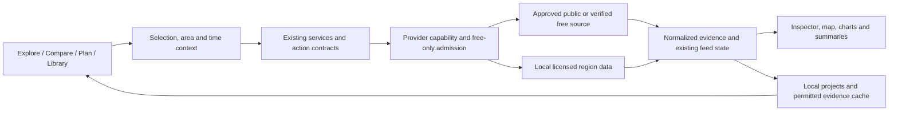

# AUREL — implementation plan

**Prepared 6 November 2026 · Original planning baseline**

**Implementation update, 7 November 2026:** the accepted core of Phases 0–5 is implemented. Read the delivery records for actual behavior, verification and limits: [Phase 0](PHASE-0.md), [Phase 1](PHASE-1.md), [Phase 2](PHASE-2.md), [Phase 3](PHASE-3.md), [Phase 4](PHASE-4.md), [Phase 5](PHASE-5.md). Selective Labs remain future work. The optional local model failed its quality gate and is not enabled; deterministic local commands are shipped. The requirements and estimates below retain the original planning context.

**Product:** the personal AUREL interface built on God's Eye View v0.3.0, local commit a33bc379.
**Operating constraint:** no additional paid APIs, hosting subscriptions, or required hardware purchases. Claude/Codex remain development tools.
**Design intent:** a beautiful, precise personal observatory for understanding places, comparing evidence, and planning real activities.

This plan is grounded in the local application, existing AUREL design work, previous hands-on Dehradun verification, and current official provider documentation. Credentials were checked for presence without printing their values. Accounts, quotas, key validity and paid entitlements were not authenticated or tested. The app remains stopped; this planning work does not change its runtime, keys, or billing settings.

## Read this as one plan

- **This document:** product direction, interface, architecture, delivery sequence and acceptance gates.
- [Detailed feature specifications](FEATURE-SPECS.md): workflows, concrete examples, implementation slices and boundaries.
- [Free data and existing credentials](FREE-DATA-PLAN.md): provider decisions, official sources, quota handling, additional-account priorities and unresolved checks.
- [Existing AUREL design](README.md): identity and prior visual verification.

## 1. The recommendation

Build **a personal spatial research desk**. Its three central questions are:

1. **What is here, and how well can I inspect it?** — AUREL Lens.
2. **What changed, and what evidence supports that conclusion?** — Chronicle.
3. **What do I want to explore, prepare, or remember?** — Fieldbook.

These share the same map, selected area, evidence inspector and local library. A weather card, satellite image, photograph, flight record and handwritten note should feel like related instruments rather than unrelated plugins.

Keep AUREL's graphite, ivory and brass identity. Make the next transformation structural: visible search, clearer hierarchy, geographically relevant tools, coordinated time controls, dependable saving, and explanations beside the data. The futuristic character should come from the map and instruments responding together.

The first useful release should let you open Dehradun, understand the available detail, inspect Rajpur Road, add weather and terrain context, save a project, and prepare a route toward Mussoorie—without needing a paid assistant or Google API.

### What success looks like

| Outcome                       | Acceptance target                                                                                                         |
| ----------------------------- | ------------------------------------------------------------------------------------------------------------------------- |
| Find and understand a place   | A first-time user can find Dehradun and explain its available detail within one minute                                    |
| Save useful work              | Save the selected place in at most three primary actions; reopen it with notes and source references intact               |
| Understand evidence           | Every quantitative card exposes source, units, applicable time and whether it is observed, modelled, derived or simulated |
| Avoid irrelevant data         | Moving from Austin to Dehradun never leaves an unlabeled Austin camera presented as local                                 |
| Keep operation free           | Tests observe no request to a disallowed billable capability, even when its credential exists                             |
| Handle absence                | Distinguish no observations, unknown coverage, outside coverage, stale data, unavailable service and setup required       |
| Preserve existing capability  | Existing scenes, share links, tracking, imports, map controls and provider configuration retain their behavior            |
| Remain usable on this machine | Benchmark on the owner's M4/16 GB Mac; do not substitute the repository's M5 benchmark for local evidence                 |

## 2. What the application already does

The application is already a substantial Vue 3/Pinia/CesiumJS product with a local Vite/Node provider layer. Its existing capabilities include live movement layers, satellite propagation, cameras, street imagery, directions, imported geospatial files, drawings, weather playback, natural events, wildlife, contextual information, cinematic styles, scene authoring, data packs and exports.

Relevant implementation evidence:

| Existing capability                  | Local evidence                                                 | Roadmap consequence                                                                                |
| ------------------------------------ | -------------------------------------------------------------- | -------------------------------------------------------------------------------------------------- |
| Application and source composition   | src/app/, src/app/sourceComposition.js; docs/APPLICATION.md    | Extend explicit factories and lifecycle ownership                                                  |
| UI controllers, stores and Vue views | docs/UI-OWNERSHIP.md; src/ui/applicationShell.js               | Improve presentation through existing owners; avoid another parallel shell                         |
| Layer/feed status and provenance     | src/data/feedState.js; src/data/layerSnapshot.js               | Extend the existing shared envelope instead of inventing conflicting status systems                |
| Provider configuration               | src/keySetupCore.mjs; server/standalone/key-setup.js           | Separate a saved credential from permission to use a capability                                    |
| Places and search                    | src/search/; src/ui/views/CommandDockView.vue                  | Surface the existing search; retain offline/coordinate paths                                       |
| Pluggable street imagery             | src/layers/streetLevel/registry.js and providers/              | Reuse provider selection, coverage and failure patterns                                            |
| Imagery comparison                   | src/ui/views/panels/ImagerySplitView.vue                       | Chronicle builds on the existing comparison control                                                |
| Routes, drawings and file imports    | src/ui/views/LayerPanelsView.vue; panels/GeoImport.vue         | Fieldbook connects existing tools                                                                  |
| Scene documents and packs            | docs/SCENE-DOCUMENT.md; docs/DIRECTOR-DATA-PACKS.md            | Preserve supported scene documents (current schema version 6); add project organization separately |
| Request throttles and budgets        | src/costEndpointThrottle.test.mjs; server/providers/traffic.js | Strengthen existing limits into an explicit free-only policy                                       |
| AUREL identity                       | src/ui/styles/aurel.css; this directory's README               | Refine the current identity instead of restarting the branding exercise                            |

This is therefore an integration and usability roadmap with selected new analysis capabilities, not a rewrite of the globe.

### Problems that deserve attention before adding more feeds

**A dense control layout hides useful work.** The desktop splits attention between two panel rails, the bottom dock, style controls and HUD. Search is less visible than it should be. On small screens, panels consume most of the map.

**The visual promise can exceed the underlying evidence.** The HUD implementation explicitly identifies some mission labels, GSD/NIIRS figures and collection-time styling as illustrative. An analytical interface needs to keep these separate from actual image metadata.

**Geographic context is inconsistent.** Previous Dehradun testing found a selected Austin camera still visible after moving to India. Regional feeds can appear empty without explaining whether the place is supported.

**More zoom does not mean more information.** The tested Dehradun patch showed aerial imagery draped over the surface, not the detailed photogrammetric city mesh available in some other places. Street View metadata existed at one Rajpur Road location, but the viewer failed with InvalidKeyMapError. Those are observations from the earlier test, not a fresh assertion about every part of Dehradun or today's provider status.

**Free registration does not establish free unlimited operation.** Saved Google, Cesium, TomTom and OpenSky credentials have different cost and eligibility rules. A colored key indicator cannot communicate that distinction.

## 3. A strict operating contract for no additional service spending

The default configuration should be **Free-only**. This is a proposed feature, not something this planning pass has activated.

- Admit public sources whose intended use is permitted, local computation, and verified free accounts with enforceable no-charge behavior.
- Block paid capabilities, trials that can become paid, uncertain entitlements and automatic paid fallbacks.
- Preserve existing credentials. A saved key must not automatically activate its provider.
- Gate each capability, not just each company: the Google-direct and Cesium-hosted routes are different integrations.
- Apply the policy before server requests, browser SDK initialization, tile acquisition, background jobs and assistant tool dispatch.
- Respect external quotas with durable accounting, conservative reserves, caching where allowed, and bounded retries.
- If remaining entitlement cannot be established safely, disable that optional capability rather than assume zero cost.
- Keep local globe navigation, coordinates, saved user overlays, notes and local tools functional when every external service is unavailable. Bundle a small Natural Earth overview in Phase 0; street-level offline geography requires the later licensed region pack.

A local counter can control this app's requests; it cannot see all usage of the same account from other apps. Budget alerts are not hard spending caps. For any account that can charge, a verified provider-side no-charge configuration is a prerequisite; otherwise it stays outside Free-only.

The long-term protection is architectural: open/downloadable data and local tools remain useful even if a hosted free service changes its terms. Existing electricity, internet and disk use remain real resource costs; the target is zero additional service charges.

See [the provider decision table](FREE-DATA-PLAN.md) for each saved credential and new source.

## 4. Information architecture: four places to work

| Destination | Primary question      | What lives here                                                                        |
| ----------- | --------------------- | -------------------------------------------------------------------------------------- |
| **Explore** | What is here?         | Search, place dossier, useful layers, object inspection, coverage                      |
| **Compare** | What changed?         | Available imagery dates, comparison slider, time tracks, evidence notes                |
| **Plan**    | What could I do here? | Routes, daylight, terrain, mapped services, field observations                         |
| **Library** | What have I saved?    | Places, projects, imported files, evidence, existing scenes and presentation sequences |

Watchlists belong to saved places/projects, rather than becoming a fifth destination. Scene creation remains in Library and contextual project actions. Settings contain appearance, providers, storage and diagnostics.

### Desktop composition

A compact top bar contains the AUREL mark, persistent place/command search, current place or area, time context and a concise data-status indicator. The task rail sits on the left. A single contextual inspector sits on the right. The timeline appears only for relevant work.

The selected map object, row, chart point and evidence card highlight together. A visible scale, north control and Return to selection action give orientation. Important attribution remains visible and unobscured.

Keep a clean research view as the default. Retain the existing dramatic scope, scanline, FLIR and other styles in an explicit Cinematic appearance. Exiting Cinematic restores the prior research presentation without changing data selections.

### Mobile composition

Use one map and a bottom sheet with collapsed, half-height and full-height states. Search stays reachable. The collapsed sheet shows the selected item and its next action. Full-height is for deliberate reading or editing, not the automatic response to every selection.

Do not show several independent floating cards over a phone map. Preserve ongoing edits when the sheet changes size, rotates or receives updated data. Touch and keyboard users must be able to perform the same core tasks.

### One inspector grammar

Every inspectable object answers, in a consistent order:

**Identity → location/extent → applicable time → evidence/source → useful actions → limitations/details.**

A route has different details from an earthquake, but both expose their origin and time. Selecting the layer name opens its explanation; toggling its switch changes visibility. These are separate actions.

## 5. Visual and interaction system

Keep the current warm identity, then test three interface directions before selecting the final shell:

| Candidate       | Purpose                                                      | How to judge it                                                      |
| --------------- | ------------------------------------------------------------ | -------------------------------------------------------------------- |
| **Observatory** | Calm dark workspace with one inspector and strong map focus  | Best for daily exploration and long sessions                         |
| **Field**       | Light, high-contrast reading surfaces with dark map controls | Best for daylight, outdoor preparation and printed briefs            |
| **Instrument**  | More compact telemetry, existing cinematic effects available | Best for expert tracking; must not become the default for every task |

These are layout/appearance prototypes, not three separate applications. Evaluate the same Dehradun search, inspection, save and compare tasks in all three. Select by legibility, task completion, unobscured map area and keyboard/mobile behavior—not which screenshot has the most decoration.

### Typography and color

Retain Manrope for interface text and JetBrains Mono for numbers, coordinates and timestamps. Use sentence case for content and actions. Reserve uppercase for short labels.

Proposed desktop scale: body 15–16 px, secondary copy 13–14 px, short metadata no smaller than 12 px, panel titles 18–22 px. Dense mode may compact spacing but must not shrink essential instructions into unreadable telemetry. Fonts should be bundled under their licenses, so core typography does not require a third-party request.

Retain the existing graphite/ivory/brass tokens as the starting point. Brass indicates selection and navigation; burgundy is a restrained brand accent. Reserve red/amber/green for defined status meanings, always accompanied by text or icons. Data palettes need perceptually sensible scales and legends; cyan is not a universal decoration.

Opaque or nearly opaque reading panels must protect contrast against actual satellite imagery. Nominal token contrast on a flat background is insufficient.

### Detail that helps

Add concise unit labels, local/UTC time conversion, readable distances, uncertainty explanations, breadcrumbs, chart-to-map cross-highlighting, source footprints, keyboard hints and undo. These create richness without adding persistent clutter.

Use short transitions to explain selection, panel movement and timeline changes. Do not animate every statistic or simulate incoming activity. Reduced-motion mode removes ambient movement and avoids long camera flights; screen-reader users receive a concise textual map summary.

### Interaction acceptance

- Target WCAG 2.2 AA for the core workflows; verify actual controls and imagery backgrounds, not just theme tokens. Supply nonvisual map summaries and accessible status announcements.
- Clear focus order; no focus theft on live updates.
- Search, inspection, layer control, drawing, saving and export usable by keyboard.
- Approximately 44 px touch targets; no hover-only essential control.
- 200% zoom, narrow phones and short landscape screens remain usable.
- Color states also use text/shape; charts have tabular summaries.
- Loading, empty, partial, stale, blocked, failed and offline states have specific copy.
- Undo/redo covers project edits; destructive removal is reversible where practical.
- English text uses the existing translation system. Preserve the 11 current translations; evaluate Hindi as a later complete workflow translation with appropriate font fallback and review.

## 6. The feature portfolio

The detailed specifications are in [FEATURE-SPECS.md](FEATURE-SPECS.md). The table below sets the implementation order.

| Feature                              | User value                                                              | Existing foundation                                       | Priority        |
| ------------------------------------ | ----------------------------------------------------------------------- | --------------------------------------------------------- | --------------- |
| Free-only policy and source ledger   | Know which services can run without additional payment                  | Provider registry, throttles, server brokers              | P0              |
| Place-aware status and honest detail | Understand what is actually available at the selected location          | Map availability, layer snapshots, street-level providers | P0              |
| Unified shell and inspector          | Find tools and read detail without losing the map                       | Vue views, Pinia stores, existing controller ownership    | P0/P1           |
| **AUREL Lens**                       | A useful dossier for a point, area or neighborhood                      | Search, context, map selection, layers                    | P1              |
| **Fieldbook**                        | Save connected places, routes, notes and evidence                       | Scenes, drawings, imports, data packs                     | P1              |
| Foothills route and daylight tools   | Prepare Dehradun/Mussoorie exploration or photography                   | Directions, terrain, local calculations                   | P1/P2           |
| Environment brief and watchlists     | See meaningful changes around saved places                              | FIRMS, weather, quakes, feed status                       | P2              |
| **Chronicle**                        | Compare available evidence through time                                 | Imagery split, weather playback, scene replay             | P2              |
| India station observations           | Distinguish actual monitors from modelled background AQ                 | Existing air-quality layer architecture                   | P2, source gate |
| Open region pack and detail overlay  | Useful local roads, structures and notes when offline                   | Geospatial imports, layer factories                       | P2/P3           |
| Explainable local assistant          | Natural-language access without mandatory API charges                   | Existing action schemas and execution                     | P3              |
| Research lenses                      | Terrain visibility, vegetation change, service access, seasonal ecology | Shared evidence and computation infrastructure            | P3/Labs         |

### Many domains, one coherent product

The same project model can support daily life, travel, photography, geography learning, environmental observation, urban research, aviation, astronomy, wildlife, infrastructure context and personal asset notes. These are templates and lenses inside the four destinations. They do not each receive a permanent panel, chatbot, database or paid integration.

The key design rule is **one question, one relevant set of instruments**. A Dehradun walking project should not start vessel streams and worldwide cameras.

## 7. Dehradun as the reference workflow

Use three related contexts: Rajpur Road for detailed urban inspection, the Dehradun–Mussoorie corridor for terrain and trip planning, and a wider Uttarakhand view for regional weather/fire context. Exact saved boundaries should be editable.

Release 1 covers steps 1–8 and basic project/brief export. Release 2 adds the dated comparison in step 9. Release 3 deepens step 10 with the licensed offline region pack; saved notes and the bundled overview already work without internet. This prevents the first release from depending on every later research feature.

The sequence:

1. Enter Dehradun in visible search, or use coordinates if online search is unavailable.
2. Show a dossier explaining the selected extent and the available map/source detail.
3. Show mapped roads/buildings as available, with data date and incompleteness acknowledged.
4. Add a weather forecast and terrain context; model resolution and elevation reference remain inspectable.
5. Query dated satellite fire observations in a bounded area using the existing FIRMS key.
6. Offer station air quality only after a real station/source is verified; otherwise show the background model as such.
7. Inspect street imagery availability and capture dates without silently invoking a paid viewer.
8. Start a route, inspect elevation and daylight, add notes/viewpoints, and save a Fieldbook.
9. Compare two suitable dated images if available; explain gaps caused by clouds or unavailable imagery.
10. Export a sourced personal brief and reopen the project with internet access disabled using only assets explicitly saved and licensed for offline use. The locally installed Node server still runs; this is not a promise of a standalone offline phone application.

**Definition of done:** this entire workflow has no dependency on a paid API or an LLM. Missing imagery, AQ stations or street panoramas are visible limitations, not blockers for the other tasks.

Do not promise facades, interiors, live pedestrians, number plates, live road status or detailed 3D geometry from the available aerial imagery. A richer interface cannot create missing source detail.

## 8. Data and application architecture

Retain Cesium, Vue, Pinia and the existing local Node process. No renderer migration, cloud database, hosted job queue or external authentication service is required.

### Extend existing contracts

**Capability policy:** add a new shared runtime policy layer, joined by stable IDs to the existing credential/setup registry and per-feature registries. The current setup registry is not already a central request-admission system. Store cost class, credential requirement, intended-use eligibility, coverage description, quota units/window, no-charge verification, retry policy, cache/export permissions, attribution and last policy-review date. Keep secret values in the current server configuration, never in this registry.

**Evidence metadata:** extend the existing layer snapshot and source records. Distinguish source observation time, valid forecast period, imagery acquisition time and local retrieval time. Add native spatial resolution/uncertainty when supplied, source dataset/version, processing method and license reference. Preserve unknown values as unknown.

**Coverage:** represent known coverage separately from query results. A successful empty query means no returned observations, not necessarily no service coverage. Distinguish known supported, known unsupported, partial and unknown. Include the selected geographic extent in every query/result association.

**Time:** retain layer-specific clocks and introduce a coordinator that requests compatible views. Static layers remain static. A forecast is never silently relabeled as a historical observation. Show the actual date chosen when a nearest available image is substituted with the user's knowledge.

**Projects:** introduce a versioned Fieldbook envelope with IDs for saved places, areas, notes, routes and evidence references. Reference or embed validated existing scene documents; do not add arbitrary fields to the strict scene schema (currently version 6). Keep existing storage keys and import semantics. Version migrations must preserve unreadable original bytes for recovery.

**Persistence:** browser storage can hold UI drafts and small records. Use the existing local-server/filesystem pattern for explicit project backups and bounded licensed datasets where appropriate. Choose one authoritative writer per project and detect conflicting tab revisions. Validate recovery after refresh, process restart, full storage, corrupt files and conflicting tabs. No new database is necessary for the first release; adopt SQLite only if measured data/query requirements justify it.

### Suggested ownership

| Responsibility                 | Existing owner to extend                                   | Proposed additions, only if needed                                 |
| ------------------------------ | ---------------------------------------------------------- | ------------------------------------------------------------------ |
| Navigation and selection       | src/ui/navigationController.js, locationNavigation.js      | Shared selected-area read model                                    |
| Layout and inspector           | src/ui/panelChrome.js, panelNavigation.js, views/, stores/ | Inspector view and four task projections                           |
| Provenance and feed status     | src/data/layerSnapshot.js, feedState.js                    | Evidence metadata validators and display helpers                   |
| Policy admission               | src/keySetupCore.mjs; server/providers/                    | Pure capability-policy module consumed by browser and Node         |
| Local projects                 | src/scenes/ and current import/export owners               | Separate Fieldbook schema, migrations and repository               |
| New source adapters            | src/sources/, src/layers/<family>/, server/providers/      | Open-Meteo/OGD adapters following existing boundaries              |
| Raster and terrain computation | supplied services; worker-friendly pure modules            | Bounded analysis workers, cancellable jobs                         |
| Local assistant                | src/voice/ schemas/session/action execution                | Optional local protocol adapter with explicit host opt-in          |
| Shutdown                       | src/app/ and server composition                            | Dispose every new timer, socket, worker and optional model process |

Respect docs/CODE-BOUNDARIES.md: portable sources do not import UI, Node, Cesium or browser globals. UI owners publish plain view objects through stores. Use the existing world-overlay host for world text, rather than new Cesium text labels.

### Free-only enforcement details

Use admission before a request is dispatched, not just a badge in settings. Browser tile SDKs and websocket startup need their own admission gates. A shared source hostname may serve multiple products, so hostname blocking alone is insufficient.

Reuse current request coalescing, throttle and budget patterns. A durable ledger records attempted upstream work conservatively, including failed requests when the provider may count them. Atomic reservation prevents two tabs or concurrent jobs from overspending a shared local allowance. A corrupted ledger or uncertain reset boundary fails closed for capped optional services.

Keep cost policy separate from normal source availability. “Blocked by Free-only” is different from “Invalid key” and different from “No coverage here.” No automatic fallback may cross from permitted to billable.

## 9. Performance, storage and privacy

The owner has a 16 GB Apple Silicon machine, shared with the browser and coding tools. Avoid making a local AI model or a planet-scale dataset a startup requirement.

Proposed budgets below are **targets to validate**, not measurements:

| Concern                   | Initial target                                                                                          |
| ------------------------- | ------------------------------------------------------------------------------------------------------- |
| Ordinary control response | p95 under 100 ms with cached/fixture data                                                               |
| Default city exploration  | Aim for 45–60 FPS; degrade gracefully toward 30 FPS on heavier approved scenes                          |
| Optional local model      | Start with a small quantized model; total runtime target around 3–5 GB, benchmark before adopting       |
| Analysis                  | One heavy raster job at a time, bounded tiles and cancellable workers                                   |
| Evidence cache            | Start with a visible 1 GB cap; pinned project assets counted separately with explicit size reporting    |
| Downloads                 | Estimate size first; bounded geographic extracts, never the whole planet by default                     |
| Background activity       | Pause nonessential refresh when hidden; stop inactive layers and area jobs                              |
| Repeated navigation       | No sustained growth after 50 city/project switches; compare process memory and resource counts          |
| Shutdown                  | Stop all project-owned processes, ports, sockets, workers and timers; preserve unrelated user processes |

Use level-of-detail aggregation, viewport culling and worker computation where profiling identifies a problem. Rendering counts are not data counts: show when a map is sampled or clustered. Do not mount multiple full globe canvases merely to implement comparison if the existing slider can serve the task.

Projects, observations and personal photographs remain local by default. Import previews explain coordinates and metadata that will be retained. Sharing/export offers removal of home coordinates, personal notes and photograph EXIF. Retain source-imposed wildlife location obfuscation.

Treat imported text and assistant context as data, never as executable instructions. Reuse current source registration, import validation, maximum sizes, path handling and local endpoint protections. A local assistant must use an allowlisted action schema, not shell access or arbitrary URLs.

### Session controls and offline scope

Provide a visible Pause live data action and a local launcher with start/stop status. End session stops only processes owned by this project, including any optional model process, and confirms released ports. No background monitoring service is installed by default.

For this roadmap, offline means the locally installed app/server can start and serve bundled assets without internet, then open saved projects and admitted local datasets. Keep fonts and essential UI assets local. Provider imagery outside a saved permitted dataset is unavailable. Browser usability at mobile widths is included; a fully standalone offline mobile package or authenticated LAN deployment is separate future scope.

## 10. Implementation sequence and dependencies

Effort ranges are planning estimates for focused engineering and validation, not promises about agent wall-clock speed. Re-estimate after the foundation audit. External provider/account checks can delay only their optional adapters.

| Phase                                       | Deliverables                                                                                                                           | Dependencies                                  | Indicative effort              | Release gate                                                                                            |
| ------------------------------------------- | -------------------------------------------------------------------------------------------------------------------------------------- | --------------------------------------------- | ------------------------------ | ------------------------------------------------------------------------------------------------------- |
| **0 — establish trust and cost boundaries** | Capability inventory; Free-only enforcement; honest HUD; geographic scope; bundled overview map; Dehradun fixtures                     | Existing code audit and policy sources        | 3–6 days                       | Per-capability browser/Node allow-deny matrix passes with saved keys; Austin/Dehradun scope test passes |
| **1 — make the interface coherent**         | Three layout prototypes; chosen responsive shell; persistent search; inspector; appearance modes                                       | Phase 0 status model                          | 5–8 days                       | Core tasks pass desktop/mobile/keyboard review; legacy controls still reachable                         |
| **2 — make it personally useful**           | AUREL Lens; Fieldbook MVP; local save/restore/export; brief presentation using saved/admitted evidence                                 | Phases 0–1                                    | 5–8 days                       | Dehradun project round-trip and failure recovery work without paid services                             |
| **3 — complete the India field workflow**   | Weather adapter; route/daylight/profile tools; FIRMS view; complete daily brief; OGD feasibility; region-pack and dated-imagery spikes | Phase 2, source admission                     | 5–8 days                       | Route/project workflow works; actual source coverage recorded honestly                                  |
| **4 — build time and research depth**       | Chronicle; evidence-linked change notes; Sentinel/terrain bounded analysis                                                             | Evidence schema and source spikes             | 7–12 days                      | No fabricated history; reproducible dated comparison and permitted export                               |
| **5 — polish and extend carefully**         | Offline region pack; watchlist reliability; optional local assistant trial; accessibility/performance hardening                        | Stable core                                   | 5–8 days, excluding large Labs | Offline and resource tests pass; no model required                                                      |
| **Labs — pursue selectively**               | Viewsheds, catchment exploration, seasonal ecology, settlement analysis                                                                | Separate proof-of-value and data-quality gate | Individually estimated         | Promote only after a useful verified prototype                                                          |

**Release 1 ends after Phase 3:** coherent interface, Lens, Fieldbook, the free Dehradun field workflow and basic brief. **Release 2 completes Phase 4:** Chronicle and evidence comparison. **Release 3 completes Phase 5:** bounded offline region pack and optional extensions. Mission templates can follow the stable Release 1 action contracts and ship with Release 2.

The core and polished research roadmap is roughly **30–50 focused engineering days** under these assumptions. Do not implement every Labs idea before delivering the first useful release. These ranges have low-to-medium confidence until Phase 0 establishes the full request graph and migration surface.

### First ten implementation tickets

1. Snapshot current behavior, scene/share compatibility and provider request paths using fixtures.
2. Define policy states and failing tests for paid fallback, saved-key autoactivation and direct browser SDK calls.
3. Implement shared admission and durable quotas using current provider helpers.
4. Extend evidence metadata and status copy without breaking current layer snapshots.
5. Fix selected-camera/location scope and analytical HUD metadata presentation.
6. Prototype the four-destination shell and common inspector with actual Dehradun content.
7. Build search → select → inspect → save as the first complete interaction.
8. Add Fieldbook schema, recovery, import/export and local backup.
9. Add bounded weather, existing FIRMS context and route/daylight tools.
10. Complete Dehradun acceptance and mobile/a11y/performance review before Chronicle.

### Work that can proceed in parallel

After shared schemas are agreed, one owner can implement the shell, another the policy/adapters, and another Fieldbook persistence. They should not all edit applicationShell.js, scene schema or the same store simultaneously. A review owner checks source terms and a test owner exercises cross-cutting failures.

Do not introduce parallel “new status,” “new provider” and “new project” systems that bypass existing owners. Agree stable interfaces first; integrate one vertical slice at a time.

## 11. Validation plan

Use test-driven development for new policy, parsing, persistence and analytical behavior. Target at least 80% coverage of new meaningful logic, with all policy-denial branches explicitly exercised; do not imply existing whole-repository coverage was measured.

**Unit:** time/coordinate conversion, coverage classification, quota reset/reservation, metadata formatting, project migrations, local command parsing, sun/elevation calculations, raster masks and license/export decisions.

**Integration:** provider timeout/429/stale/partial responses; no credentials in logs or exports; policy blocks before network dispatch; rapid location changes immediately clear/relabel old geographic context and discard stale responses; late Austin replies cannot repopulate a Dehradun selection; cancellation stops work; two tabs share budgets; corrupt cache/project recovery; source-specific payload limits.

**Browser:** search/select/inspect/save; Dehradun → Austin → Dehradun; known unsupported area; startup without internet with the local server running; chronological comparison; all drawers at phone/landscape sizes; keyboard-only workflows; reduced motion; invalid key, missing key and exhausted quota as separate states.

**Regression:** existing scenes and share links; cockpit/tracking and camera authority; current imports; street imagery provider switching; scene recording/playback; translation extraction; disposal and server shutdown.

**Analytical correctness:** compare sun/terrain calculations against trusted reference fixtures; test missing heights, mixed vertical references, antimeridian extents, clouds, no-data, fractional raster intersections and source resolution. A plausible-looking map is not sufficient.

**No-charge proof:** run browser and Node network interception with realistic placeholder credentials and fixtures. Assert no disallowed endpoint/SDK initialization across startup, restored links, auto-selected maps, voice tools, background refresh and fallback paths. Live smoke checks use only explicitly admitted free capabilities and tiny bounded requests; they never consume a paid key to prove a button works.

At the relevant release gates run existing scripts: npm test, npm run build, npm run check:boundaries, npm run format:check, and npm run i18n. Run npm run test:perf, whose runner enables timing budgets, and focused browser QA for affected rendering paths. Required security/dependency checks precede any future commit. No build or runtime test was rerun for this documentation-only planning pass.

## 12. Decisions and unresolved checks

**Decided:** local-first; free-only default; preserve current engine and original project attribution; retain AUREL identity; reuse scenes and source abstractions; prioritize Lens/Fieldbook before advanced AI; start with Dehradun.

**Verify before enabling:** Cesium plan and no-charge behavior; TomTom evaluation/production entitlement; OpenSky operational license; OGD Dehradun station freshness; Bhuvan's specific layers and permitted uses; exact usable Sentinel scenes; regional extract size; local model memory/quality.

**Do not make prerequisites:** new paid maps, cloud accounts, external inference, social login, realtime collaboration, always-on servers, paid alert services, full-planet downloads or elaborate microservices.

**Later, if evidence justifies them:** Hindi localization, richer local vector rendering, offline routing engine, desktop packaging and selected research lenses. A richer local region pack is preferable to promising a free global digital twin.

The central release decision is simple: ship a complete, trustworthy personal workflow first, then deepen it. AUREL should help you discover, understand and keep evidence about the world—not merely add more illuminated controls.
